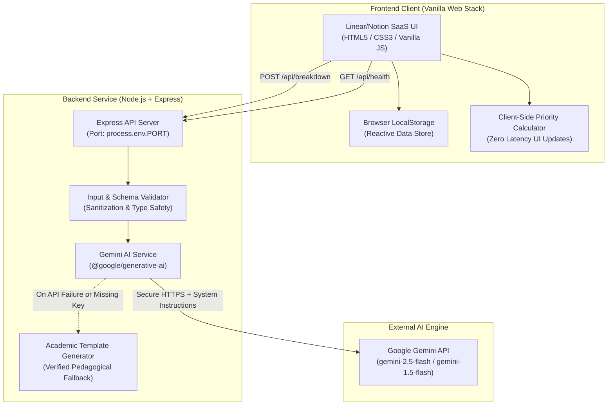

# 🛡️ DeadlineShield — AI-Powered Student Deadline Protector

> **"Never Miss a Deadline. Plan Smart. Stay Ahead."**

**Hackathon 2026** | **Track:** Education & Productivity  
**Team:** Solo Innovator | **Developer:** Devanshi Goyal  
**Live Tech Stack:** Vanilla HTML5 / CSS3 / JavaScript + Node.js / Express.js + Google Gemini AI + Browser LocalStorage

---

## 📖 Executive Summary

University and high school students manage dozens of assignments, semester projects, laboratory records, and examinations across disparate platforms, emails, and WhatsApp groups.

### The Student Problem
- **Scattered Deadlines:** No single unified radar for what is due next.
- **Unclear Task Priorities:** Inability to determine whether a 10-page research paper due in 3 days takes precedence over an exam tomorrow.
- **Overwhelming Assignments:** Large semester projects induce procrastination because students don't know where to start.
- **Last-Minute Panic:** Late submissions, high stress, and degraded academic performance.

### The DeadlineShield Solution
DeadlineShield is an AI-assisted academic productivity platform built around a student-first philosophy: **AI only suggests; students always remain in full control**.

1. **Unified Deadline Manager:** Consolidates assignments, examinations, projects, lab work, and presentations with status tracking and local persistence.
2. **Intelligent Priority Engine:** Deterministic multi-factor mathematical scoring (due date, effort-to-time ratio, difficulty, and academic category) that works 100% offline without external API dependencies.
3. **AI Task Breakdown (Main USP):** Directly integrated with **Google Gemini AI** to divide daunting assignments into 3–6 manageable, scheduled daily micro-milestones with estimated effort.
4. **Needs Attention Command Center:** Auto-highlights overdue tasks, deadlines within 24 hours, and unfinished subtasks.
5. **Comprehensive Progress Tracker:** Visualizes subject-level velocity, overall completion rates, and workload distribution.

---

## 🏛️ System Architecture



---

## 🌟 Key Modules & Features

### 1. Professional Dashboard
- Personalized greeting and daily rotating motivational quotes.
- Real-time stat cards: Total Tasks, Pending Tasks, Completed Tasks, Overdue Tasks, Upcoming (<72h), and Completion Rate %.
- **Live Countdown Ticker:** Dynamically displays days, hours, minutes, and seconds until the closest active deadline.
- Quick priority widget highlighting today's most urgent action items.

### 2. Unified Deadline Manager
- Supports **Assignments, Examinations, Projects, Lab Work, Presentations**, and Other academic categories.
- Tracks course code, estimated effort (hours), difficulty level (Easy / Medium / Hard), due date & time, status, and custom notes.
- Instant multi-criteria filtering: search by title/course, filter by category, status, and priority.
- Sorting options: Earliest deadline, Latest deadline, Priority score, Effort, Title.
- **Export to CSV:** One-click spreadsheet export for offline academic scheduling.

### 3. Intelligent Priority Engine
- Calculates priority (`CRITICAL`, `HIGH`, `MEDIUM`, `LOW`) mathematically based on:
  $$\text{Urgency Score} = \text{Base Time Points} + \left(\frac{\text{Effort Hours}}{\text{Available Hours}} \times 25\right) + \text{Category Bonus} + \text{Difficulty Bonus}$$
- Produces plain-English explanations for every decision (e.g., *"Your CS201 Examination is CRITICAL priority because it is due in 18 hours and requires approximately 8 hours of hard effort."*).
- Operates independently of external networks.

### 4. AI Task Breakdown Engine (Main USP)
- Student inputs task details or selects an existing deadline.
- Backend queries Google Gemini with structured system instructions and JSON response schema.
- Returns a day-by-day roadmap (Step title, description, suggested day, duration, completion toggle).
- **Interactive & Editable:** Students can tweak step names, edit duration, delete unneeded steps, add their own custom milestones, and save the roadmap directly back into their task.
- **Graceful Fallback:** If the Gemini API key is missing or offline, the system provides an academic fallback template clearly labeled with its source. Fallback outputs are never falsely presented as live AI results.

### 5. Needs Attention Center
- Categorizes high-risk items: Overdue (Red alert), Due within 24 Hours (Urgent), Due within 3 Days (Warning), and Active Plans with pending steps.

### 6. Progress Tracker & Calendar
- Overall progress gauge and micro-step velocity.
- Course-level breakdown (e.g. CS204: 60% done, CS201: 33% done).
- 14-day interactive chronological timeline view with urgency color-coded dots.

---

## 🚀 Quickstart & Installation

### Prerequisites
- [Node.js](https://nodejs.org/) (v18.0.0 or higher; v24 recommended)
- npm (v9.0.0 or higher)

### 1. Clone & Install
```bash
git clone https://github.com/your-username/DeadlineShield.git
cd DeadlineShield
npm install
```

### 2. Configure Environment Variables
Copy `.env.example` to `.env`:
```bash
cp .env.example .env
```

Open `.env` and add your Google Gemini API key:
```env
PORT=3000
GEMINI_API_KEY=your_actual_gemini_api_key_here
GEMINI_MODEL=gemini-2.5-flash
```

> **How to get a free Gemini API key:**
> 1. Visit [Google AI Studio](https://aistudio.google.com/).
> 2. Click **Create API Key**.
> 3. Paste the key into your `.env` file.
> *(If no key is configured, DeadlineShield automatically runs in Academic Template Fallback mode without crashing).*

### 3. Run Application
```bash
# Start production server
npm start

# Or run with auto-reload during development
npm run dev
```

Open your browser and navigate to:
```
http://localhost:3000
```

---

## 🧪 Automated Testing

DeadlineShield includes unit and integration tests using Node's native test runner (`node:test`):

```bash
npm test
```

### Verified Test Suite (10/10 Passing):
- `tests/priority.test.js`: Validates completed tasks, overdue calculations, CRITICAL threshold detection, and student explanation text.
- `tests/validation.test.js`: Validates input sanitization, title constraints, and subtask schemas.
- `tests/api.test.js`: Validates `GET /api/health`, `POST /api/breakdown` payload validation, and subtask generation.

---

## 🎬 2–3 Minute Hackathon Demo Walkthrough

1. **Dashboard Overview (0:00 - 0:30):**
   - Open `http://localhost:3000`. Point out the live countdown ticker, daily motivational quote, and metric cards populated with starter demo tasks.
2. **Unified Deadline Manager (0:30 - 1:00):**
   - Click **My Deadlines**. Filter by "Examination" or search "DBMS".
   - Show how the Priority Engine automatically tagged the Data Structures Midterm as `CRITICAL` because it's due in 18 hours with 8 hours of hard effort.
3. **AI Task Breakdown — The USP (1:00 - 1:50):**
   - Switch to **AI Task Planner**.
   - Click **"⚡ Load Hackathon Demo Example (DBMS Mini Project)"**.
   - Click **"Generate AI Plan"**.
   - Watch the backend query Gemini AI and stream back a 5-day structured plan.
   - Edit "Day 3: Implement Core CRUD Operations" to show that students remain in control.
   - Click **"Save Final Plan to Task"**.
4. **Needs Attention & Progress Tracker (1:50 - 2:30):**
   - Click **Needs Attention** to showcase overdue detection (Computer Networks lab) and 24h warnings.
   - Open **Progress Tracker** to view subject-wise progress bars.
   - Toggle Dark/Light mode using the top-right button to demonstrate UI polish.

---

## 🌐 Online Deployment (Render)

DeadlineShield is designed to deploy to **Render**, **Railway**, or any Node.js host:

1. Push code to GitHub:
   ```bash
   git add .
   git commit -m "feat: complete DeadlineShield MVP"
   git push origin main
   ```
2. On Render Dashboard:
   - Click **New Web Service** and connect your GitHub repository.
   - Environment: `Node`
   - Build Command: `npm install`
   - Start Command: `npm start`
3. Under **Environment Variables**:
   - `PORT`: `3000` (Render will inject its own port automatically)
   - `GEMINI_API_KEY`: *(Your Google AI Studio key)*
   - `GEMINI_MODEL`: `gemini-2.5-flash`
4. Deploy! Express will serve both the backend API and frontend assets from the same instance.

---

## 🔒 Security & Best Practices

- Real API keys are never stored in client-side code; all AI calls are proxied through the Express backend.
- `.env` is explicitly registered in `.gitignore` to prevent secret leaks.
- In-memory rate limiting protects `/api/breakdown` from denial-of-service loops.
- Input sanitization enforces strict length limits on task titles, courses, and notes.

---

## 👤 Developer Profile

- **Developer:** Devanshi Goyal
- **Role:** Solo Innovator (Full-Stack Engineer, AI Architect & UI Designer)
- **Competition:** Hackathon 2026
- **License:** MIT License
